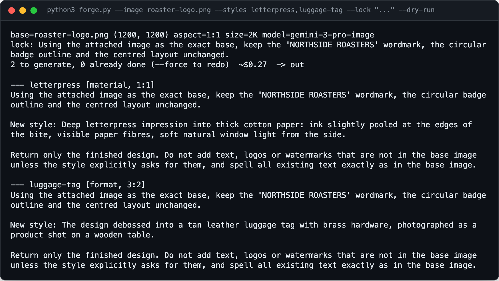
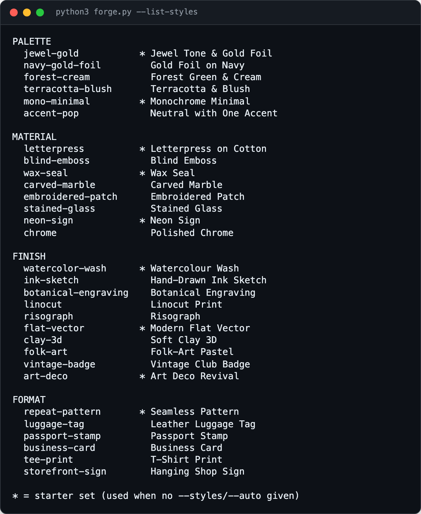

<div align="center">

<h1>logo-forge</h1>

<p><b>One logo in, dozens of styled variants out.</b></p>

<p><i>Image models love to "improve" your lettering. logo-forge pins the text and outline down first, then restyles everything else.</i></p>

<h6>


</h6>

<a href="#how-it-works"><b>How it works</b></a> ·
<a href="#install"><b>Install</b></a> ·
<a href="#usage"><b>Usage</b></a> ·
<a href="#styles"><b>Styles</b></a>

<br><br>



<sub>Real <code>--dry-run</code> output on a made-up "Northside Roasters" logo, run with no API key, so nothing was sent to Gemini.</sub>

</div>

<br>

## The problem

Ask an image model to "make this logo letterpress" and it will often redraw the letters,
reshape the outline or invent a tagline. Doing it style by style in a chat window is slow and
leaves no record of what worked. logo-forge runs the whole batch from one command: it writes a
sentence that locks what must not change, combines it with each style, generates in parallel
with Gemini image editing, scores the results for fidelity and lays them out in a gallery.
Single Python file, standard library only.

## How it works

<table>
<tr>
<td width="33%" valign="top">

**1 · Lock**

A vision model reads the base image and writes one sentence pinning what must survive, such as
*"keep the interlocking monogram, the shield outline and the centred layout unchanged"*, and
records the exact text in the design. Override with `--lock`.

</td>
<td width="33%" valign="top">

**2 · Restyle**

Each prompt is `lock + style + guard rails`, sent with the base image and any `--ref` images.
Each style changes one axis only: palette, material, finish, theme or format. Runs in parallel
with retries and model fallback.

</td>
<td width="33%" valign="top">

**3 · Review**

With `--review`, a vision model compares each result with the original and scores it 1-5,
flagging misspelled text or a changed outline. `out/<name>/index.html` shows every variant
with its score and prompt.

</td>
</tr>
</table>

## Features

- **Text and outline locked.** The lock sentence is derived from the image and repeated in every prompt, with a guard rail against added text or watermarks.
- **30 built-in styles.** Grouped into palette, material, finish and format; 9 of them form the starter set used when you pass no styles.
- **Styles from anywhere.** Mix library slugs, a whole `axis:`, your own JSON file and free text in one `--styles` list.
- **Tailored ideas.** `--auto N` asks the model for N directions based on the image and your `--brief`, saved to a file you can edit and feed back.
- **Fidelity scores.** `--review` rates each result 1-5 and names what drifted, so you know which to regenerate.
- **Aspect that fits.** Output matches the base image's aspect ratio, except styles that need their own (patterns 1:1, product shots 3:2).
- **Resumable.** `manifest.json` records model, latency, cost and review per image; rerunning skips finished styles.
- **Model fallback.** If the chosen image model is unavailable it falls back through cheaper Gemini image models.
- **Cost up front.** `--dry-run` prints every prompt and the estimated spend without calling the image API.

## Install

Python 3.10+ and a Gemini API key. No packages to install.

```bash
git clone https://github.com/parthchandak02/logo-forge.git
cd logo-forge
export GEMINI_API_KEY=...        # or put GEMINI_API_KEY=... in ./.env
```

## Usage

```bash
python3 forge.py --image logo.png                                  # the 9 starter styles
python3 forge.py --image logo.png --styles letterpress,axis:format --dry-run   # prompts and cost only
python3 forge.py --image logo.png --brief "Family bakery in Lisbon since 1962" --auto 8 --review
python3 forge.py jobs/coffee/job.json --only mug neon --force      # redo two styles from a job file
python3 forge.py --list-styles                                     # the style library
open out/logo/index.html                                           # the gallery
```

## Styles

<div align="center">

<br><sub>The built-in library from <code>styles.json</code>. <code>--list-styles format</code> shows one axis.</sub>
</div>

<br>

`--styles` takes a comma list mixing any of:

| Form | Example |
|---|---|
| Library slug | `letterpress,neon-sign` |
| Whole axis | `axis:palette` |
| Your style file | `my-styles.json` (array of `{slug, title, axis, prompt, aspect?}`) |
| Free text | `"pixel art with an 8-bit palette"` |

`--auto N` saves its ideas to `out/<name>/styles.suggested.json`; edit it and pass it back with
`--styles` to iterate. Themes come out far more personal when `--brief` names concrete things
(places, hobbies, dates, objects) than when it is generic.

## Cost

Roughly $0.13 per image on `gemini-3-pro-image` (best at keeping lettering intact) and about
$0.07 on `gemini-nano-banana-2.1`. Analysis, suggestions and reviews use a flash text model and
cost fractions of a cent. Generated images carry Google's SynthID watermark.

<details>
<summary><b>Job files</b></summary>

For anything you will rerun, put the settings in a JSON file. Paths are relative to the file,
and CLI flags override it:

```json
{
  "image": "logo.png",
  "refs": ["palette-swatch.png"],
  "brief": "Neighbourhood coffee roaster; bike delivery, rainy mornings",
  "styles": ["mono-minimal", "letterpress", "axis:format", "hand-painted on a ceramic mug"],
  "auto": 6,
  "review": true,
  "out": "out"
}
```

The `jobs/` and `out/` folders are git-ignored; keep your own logos and outputs there. See
[`examples/job.json`](examples/job.json).

</details>

<details>
<summary><b>All options</b></summary>

| Flag | Default | |
|---|---|---|
| `--image` | | Base image (png, jpg, webp) |
| `--ref` | | Extra reference image, repeatable |
| `--brief` | | Context for the lock and `--auto` themes |
| `--lock` | derived | Sentence describing what must not change |
| `--styles` | starter set | See [Styles](#styles) |
| `--auto N` | 0 | Model-suggested styles |
| `--only` | | Run only slugs containing any of these words |
| `--variants N` | 1 | Images per style |
| `--model` | `gemini-3-pro-image` | Image model; `gemini-nano-banana-2.1` is about half the price |
| `--text-model` | `gemini-flash-latest` | For lock, suggestions and review |
| `--aspect` | `auto` | Or `1:1`, `3:4`, `16:9`, ... |
| `--size` | `2K` | `1K`, `2K`, `4K` |
| `--out` | `out/<image name>` | Output folder (`out` when using a job file) |
| `--workers` / `--retries` | 3 / 3 | Parallel requests and retries per image |
| `--review` | off | Fidelity score per image |
| `--raw` | off | Send style prompts verbatim, no lock |
| `--no-analyze` | off | Skip image analysis and use the generic lock |
| `--force` | off | Regenerate finished styles |
| `--dry-run` | | Print prompts and estimated cost, generate nothing |
| `--gallery` | | Rebuild the gallery from the manifest |
| `--list-styles [AXIS]` | | Show the style library |
| `--env-file` | `./.env` | File containing `GEMINI_API_KEY=` |

</details>

<details>
<summary><b>Tips</b></summary>

- Short in-image text (dates, 2-4 word captions) renders cleanly; longer strings drift.
- If a style keeps redrawing the letters, find it with `--review`, then rerun just that one with
  `--only <slug> --force`, or tighten the wording with `--lock`.
- A clean, high-contrast base image (flat logo on white) gives the most faithful results.

</details>

<details>
<summary><b>Project layout</b></summary>

```
forge.py          The whole CLI: lock, style resolution, generation, review, gallery
styles.json       The 30 built-in styles
examples/job.json A sample job file
```

</details>

<br>

<div align="center">
<sub>Built with the Python standard library and the Gemini API. MIT licensed.</sub>
</div>
